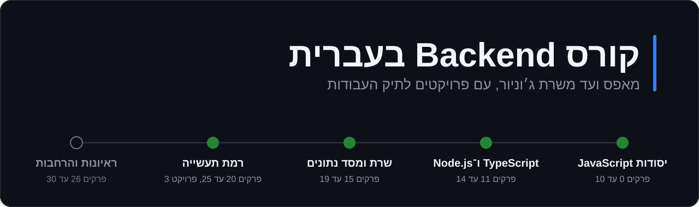
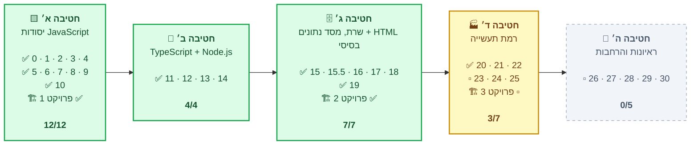
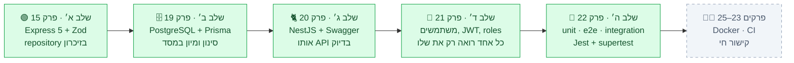
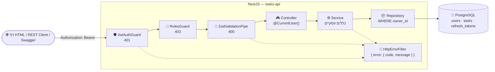
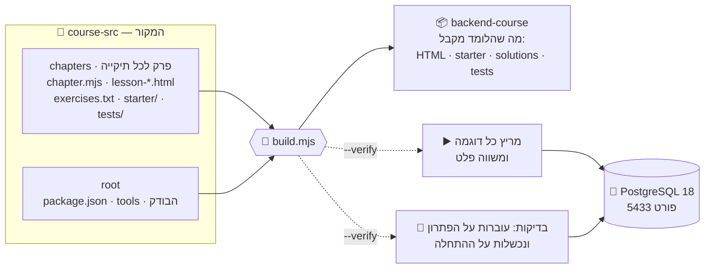

<!-- נוצר אוטומטית: node course-src/scripts/make-readme.mjs — לא לערוך ביד -->
<p align="center">
  
</p>

<p align="center">
  
  
  
  
  
  
  
  
  
</p>

<p align="center">
  <a href="https://yeudaba.github.io/backend-course-he/"></a>
  
  
</p>

<div align="center">

| 📚 פרקים ופרויקטים מוכנים | 🎓 שיעורים | ✍️ תרגילים | 🤖 קובצי בדיקה | ▶️ דוגמאות שרצות באימות |
|:-:|:-:|:-:|:-:|:-:|
| **26** | **110** | **570** | **359** | **564** |

</div>

---

## 🎯 על הקורס

קורס **Backend** שלם בעברית ללמידה עצמית — מ"מה זה משתנה" ועד שרת **NestJS** מאובטח עם **PostgreSQL**, ובסופו פרויקט דגל לתיק העבודות. הוא נבנה ללומד אחד ספציפי (בוגר הנדסת תוכנה שזוכר מושגים אבל לא תחביר, עובד על Mac עם VS Code), והמטרה ברורה: **משרת Junior Backend**.

<table>
<tr>
<td width="50%" valign="top">

### ✨ מה מיוחד
- 🇮🇱 **עברית פשוטה**, מונחים באנגלית, ומילון עם הגייה
- 🧰 **קופסת "לפני שמתחילים"** בכל פרק — מה להתקין ב־Mac, וקישורים רשמיים
- 🎨 **איור SVG בכל שיעור** — מותאם למצב כהה ולימין־לשמאל
- ✍️ **25 תרגילים בכל פרק**, ב־5 רמות
- 🔍 **דף פתרונות נפרד** — עם "למה" ו"טעויות נפוצות"

</td>
<td width="50%" valign="top">

### 🔬 איך מבטיחים שזה נכון
- ▶️ **כל דוגמה רצה** בזמן הבנייה, והפלט חייב להיות זהה למה שכתוב בשיעור
- 🤖 **כל בדיקה** חייבת לעבור על הפתרון — **ולהיכשל** על קובץ ההתחלה
- 🧬 **מפרק 22, הלומד כותב בדיקות** — והבודק מכניס באגים לקוד (mutation testing) ובודק שהן תופסות אותם
- 🗄️ **SQL מול PostgreSQL 18 אמיתי**, כולל מרוצים עם שני חיבורים
- 🌐 **CORS ודפי HTML** נבדקים בדפדפן אמיתי
- 🧾 אף פלט או הודעת שגיאה לא "הומצאו"

</td>
</tr>
</table>

### 📈 חמש רמות בכל פרק

| רמה | תרגילים | סוג | |
|:-:|:-:|---|:-:|
| 1 | E01–E05 | 🧠 הבנה וקריאת קוד | |
| 2 | E06–E12 | ✏️ כתיבה בסיסית | 🤖 |
| 3 | E13–E19 | 🧩 שילוב כמה נושאים | 🤖 |
| 4 | E20–E23 | 🐛 **תיקון באגים** — קובץ ההתחלה מכיל תקלות אמיתיות | 🤖 |
| 5 | E24–E25 | 🏆 אתגר | 🤖 |

---

## 🗺️ מפת הדרך

> 🟩 חטיבה מוכנה &nbsp;·&nbsp; 🟨 בעבודה &nbsp;·&nbsp; ⬜ בתוכנית &nbsp;·&nbsp; ✅ פרקים מוכנים &nbsp;·&nbsp; ▫️ פרקים בתוכנית &nbsp;·&nbsp; המספרים — מספרי הפרקים



---

## 📚 תוכן הקורס

### חטיבה א׳ — יסודות JavaScript

| | | נושא | שיעורים | תרגילים | בדיקות | מצב |
|:-:|---|---|:-:|:-:|:-:|:-:|
| 🧰 | [פרק 0](backend-course/00-setup/index.html) | **הכנה: המחשב, VS Code והרצה ראשונה** | 5 | 8 | — | ✅ |
| 🔤 | [פרק 1](backend-course/01-values-variables/index.html) ⚡ | **ערכים ומשתנים** | 3 | 25 | — | ✅ |
| ➗ | [פרק 2](backend-course/02-operators-strings/index.html) ⚡ | **פעולות ומחרוזות** | 4 | 25 | — | ✅ |
| 🔀 | [פרק 3](backend-course/03-conditions/index.html) ⚡ | **תנאים** | 4 | 25 | — | ✅ |
| 🔁 | [פרק 4](backend-course/04-loops/index.html) ⚡ | **לולאות** | 4 | 25 | — | ✅ |
| 🧩 | [פרק 5](backend-course/05-functions/index.html) ⚡ | **פונקציות** | 4 | 25 | 🤖 20 | ✅ |
| 📚 | [פרק 6](backend-course/06-arrays/index.html) ⚡ | **מערכים** | 4 | 25 | 🤖 20 | ✅ |
| 🗂️ | [פרק 7](backend-course/07-objects/index.html) ⚡ | **אובייקטים** | 4 | 25 | 🤖 20 | ✅ |
| 🐞 | [פרק 8](backend-course/08-modules-errors/index.html) | **ארגון קוד ואיתור תקלות** | 4 | 25 | 🤖 20 | ✅ |
| 💰 | [פרויקט 1](backend-course/08p-project-expenses/index.html) | **מנהל הוצאות בשורת הפקודה** | 6 | — | 🤖 3 | ✅ |
| 🌿 | [פרק 9](backend-course/09-git/index.html) | **Git ו־GitHub** | 4 | 25 | — | ✅ |
| ⏳ | [פרק 10](backend-course/10-async/index.html) | **אסינכרוניות** | 4 | 25 | 🤖 20 | ✅ |

<details>
<summary>📖 <b>כל השיעורים בחטיבה</b></summary>

| | השיעורים |
|---|---|
| 🧰 **פרק 0** | 1. קבצים, תיקיות ונתיבים<br>2. התקנת VS Code ו־Node.js<br>3. סיור ב־VS Code<br>4. ה־Terminal: שש פקודות שצריך<br>5. תוכנית ראשונה וקריאת שגיאות |
| 🔤 **פרק 1** | 1. ערכים: טקסט, מספרים ואמת/שקר<br>2. משתנים: const ו־let<br>3. undefined, null, ומה עם var |
| ➗ **פרק 2** | 1. חשבון וסדר פעולות<br>2. מחרוזות ו־template literals<br>3. המרות, NaN ומלכודות<br>4. גישור: קריאת ביטוי צעד אחר צעד <sub>יחידת גישור</sub> |
| 🔀 **פרק 3** | 1. השוואות: === ו־!==<br>2. if, else if, else<br>3. &&, ||, ! ו־truthy/falsy<br>4. ternary, switch ובדיקת קלט |
| 🔁 **פרק 4** | 1. while — חזור כל עוד<br>2. for — לולאה עם מונה<br>3. דפוסי צבירה, break ו־continue<br>4. לולאות על מחרוזות ולולאות מקוננות |
| 🧩 **פרק 5** | 1. פונקציה ראשונה: פרמטרים ו־return<br>2. return לעומק, ברירות מחדל ו־guard clauses<br>3. arrow functions, scope ופונקציה כערך<br>4. גישור: פירוק בעיה לפונקציות + הבודק האוטומטי <sub>יחידת גישור</sub> |
| 📚 **פרק 6** | 1. מערך: יצירה, אינדקס, הוספה והסרה<br>2. מעבר על מערך, split ו־join<br>3. map, filter, find, some, every<br>4. reduce, sort, ומה משנה את המערך |
| 🗂️ **פרק 7** | 1. אובייקט: שדות, גישה ושינוי<br>2. מערך של אובייקטים<br>3. הפניות, העתקה, destructuring ו־JSON<br>4. Map, Set וגישור: נתונים מקושרים <sub>כולל יחידת גישור</sub> |
| 🐞 **פרק 8** | 1. מודולים: קוד בכמה קבצים<br>2. throw, try/catch ו־finally<br>3. stack trace וה־Debugger של VS Code<br>4. ESLint ושיטה לאיתור באגים |
| 💰 **פרויקט 1** | 1. תכנון: מבנה, כלים חדשים והקמה<br>2. שלב 1: הלוגיקה (expenses.js) <sub>🤖 PR1-LOGIC</sub><br>3. שלב 2: שמירה בקובץ (storage.js) <sub>🤖 PR1-STORAGE</sub><br>4. שלב 3: שורת הפקודה (cli.js) <sub>🤖 PR1-CLI</sub><br>5. שלב 4: גימור, README ובדיקה עצמית<br>6. פתרון לדוגמה והחלטות עיצוב <sub>🔒 אחרי שסיימת</sub> |
| 🌿 **פרק 9** | 1. commit ראשון: שלושת האזורים<br>2. diff, ביטול שינויים ו־.gitignore<br>3. branches, merge והתנגשויות<br>4. GitHub: push, Pull Request וסודות |
| ⏳ **פרק 10** | 1. סינכרוני, אסינכרוני ו־event loop<br>2. callbacks ו־error-first<br>3. Promises<br>4. async/await, מקביליות וכשלים <sub>כולל יחידת גישור</sub> |

</details>

### חטיבה ב׳ — TypeScript ו־Node.js

| | | נושא | שיעורים | תרגילים | בדיקות | מצב |
|:-:|---|---|:-:|:-:|:-:|:-:|
| 🔷 | [פרק 11](backend-course/11-typescript/index.html) | **TypeScript בסיסי** | 4 | 25 | 🤖 20 | ✅ |
| 📐 | [פרק 12](backend-course/12-design/index.html) | **מודלים ותכנון קוד** | 4 | 25 | 🤖 20 | ✅ |
| 📦 | [פרק 13](backend-course/13-node-npm/index.html) | **Node.js ו־npm** | 4 | 25 | 🤖 20 | ✅ |
| 🌐 | [פרק 14](backend-course/14-http/index.html) | **HTTP ורשת בסיסית** | 4 | 25 | 🤖 20 | ✅ |

<details>
<summary>📖 <b>כל השיעורים בחטיבה</b></summary>

| | השיעורים |
|---|---|
| 🔷 **פרק 11** | 1. מה זה TypeScript, וטיפוסים בסיסיים<br>2. אובייקטים, מערכים ופונקציות<br>3. union, literal types ו־narrowing<br>4. unknown, any ו־type guards |
| 📐 **פרק 12** | 1. מחלקות<br>2. שגיאות משלך, ירושה והרכבה<br>3. interface, repository, service והזרקת תלויות<br>4. גישור: טיפוסים מול בדיקה בזמן ריצה <sub>יחידת גישור</sub> |
| 📦 **פרק 13** | 1. npm ו־package.json<br>2. process: ארגומנטים, סביבה וקוד יציאה<br>3. הגדרות וסודות: .env<br>4. המודולים המובנים: fs, path, crypto, readline |
| 🌐 **פרק 14** | 1. בקשה ותשובה: URL, methods ו־status<br>2. headers, JSON ו־stateless<br>3. כלים: curl, REST Client ו־DevTools<br>4. שרת עם node:http ולקוח עם fetch |

</details>

### חטיבה ג׳ — שרת, מסד נתונים ו־HTML בסיסי

| | | נושא | שיעורים | תרגילים | בדיקות | מצב |
|:-:|---|---|:-:|:-:|:-:|:-:|
| 🚂 | [פרק 15](backend-course/15-express/index.html) | **Express ו־REST** | 4 | 25 | 🤖 20 | ✅ |
| ✅ | [פרויקט 2](backend-course/15p-project-tasks/index.html) | **API לניהול משימות — שלב א׳: בזיכרון** | 6 | — | 🤖 5 | ✅ |
| 🎨 | [יחידה 15.5](backend-course/15w-web-bridge/index.html) | **גישור: HTML, CSS ו־fetch** | 4 | 12 | 🤖 6 | ✅ |
| 🗄️ | [פרק 16](backend-course/16-sql/index.html) | **SQL מהיסוד** | 4 | 25 | 🤖 20 | ✅ |
| 🔗 | [פרק 17](backend-course/17-relations/index.html) | **קשרים ושאילתות** | 4 | 25 | 🤖 20 | ✅ |
| ⚖️ | [פרק 18](backend-course/18-consistency/index.html) | **עקביות וביצועים** | 4 | 25 | 🤖 20 | ✅ |
| 🔺 | [פרק 19](backend-course/19-prisma/index.html) | **Prisma ו־migrations** | 4 | 25 | 🤖 21 | ✅ |

<details>
<summary>📖 <b>כל השיעורים בחטיבה</b></summary>

| | השיעורים |
|---|---|
| 🚂 **פרק 15** | 1. השרת הראשון ב־Express<br>2. middleware, שגיאות ו־404<br>3. תכנון REST: כתובות, pagination ושכבות<br>4. בדיקת קלט עם Zod |
| ✅ **פרויקט 2** | 1. תכנון, הקמה ו־Git<br>2. שלב 1: schema, repository ו־service <sub>🤖 PR2-SCHEMA, PR2-SERVICE</sub><br>3. שלב 2: routes, ולידציה ושגיאות <sub>🤖 PR2-API</sub><br>4. שלב 3: סינון, מיון, pagination וסטטיסטיקה <sub>🤖 PR2-LIST</sub><br>5. שלב 4: README, GitHub ובדיקה עצמית<br>6. פתרון לדוגמה והחלטות עיצוב <sub>🔒 אחרי שסיימת</sub> |
| 🎨 **יחידה 15.5** | 1. HTML: מבנה, טקסט וטפסים<br>2. CSS: מספיק כדי שלא ייראה שבור<br>3. JavaScript בדפדפן ו־CORS<br>4. דף הדגמה לפרויקט 2 <sub>🤖 PR2-WEB</sub> |
| 🗄️ **פרק 16** | 1. מסד נתונים, טבלאות ו־psql<br>2. SELECT: לשלוף, לסנן, למיין<br>3. NULL וצבירות<br>4. יצירת טבלאות ושינוי נתונים |
| 🔗 **פרק 17** | 1. מפתחות וקשרים בין טבלאות<br>2. JOIN: לשלב טבלאות<br>3. GROUP BY ו־HAVING<br>4. תת־שאילתות, WITH ופונקציות חלון |
| ⚖️ **פרק 18** | 1. Transactions: הכול או כלום<br>2. מקביליות ו־race conditions<br>3. Indexes ו־EXPLAIN<br>4. N+1 ו־pagination מהירה |
| 🔺 **פרק 19** | 1. ORM, Prisma והחיבור הראשון<br>2. Schema, קשרים ו־migrations<br>3. שאילתות, transactions ושגיאות<br>4. פרויקט 2 עובר ל־PostgreSQL <sub>🤖 PR2-DB</sub> |

</details>

### חטיבה ד׳ — רמת תעשייה

| | | נושא | שיעורים | תרגילים | בדיקות | מצב |
|:-:|---|---|:-:|:-:|:-:|:-:|
| 🐈 | [פרק 20](backend-course/20-nestjs/index.html) | **NestJS** | 4 | 25 | 🤖 21 | ✅ |
| 🔐 | [פרק 21](backend-course/21-auth/index.html) | **כניסה והרשאות** | 5 | 25 | 🤖 22 | ✅ |
| 🧪 | [פרק 22](backend-course/22-testing/index.html) | **בדיקות** | 5 | 25 | 🤖 21 | ✅ |
| 🐳 | פרק 23 | **Linux ו־Docker** <br><sub>Dockerfile, Compose, volumes — הכול עולה בפקודה אחת</sub> | | | | 🗓️ |
| 🏭 | פרק 24 | **API של מוצר אמיתי** <br><sub>logs, request ID, אזורי זמן, idempotency, rate limit</sub> | | | | 🗓️ |
| 🚀 | פרק 25 | **CI ופריסה** <br><sub>GitHub Actions, secrets, healthcheck, HTTPS — קישור חי</sub> | | | | 🗓️ |
| ☕ | פרויקט 3 | **פרויקט הדגל: חנות ציוד קפה** <br><sub>JWT, עגלה←הזמנה, transactions, idempotency, Docker, CI</sub> | | | | 🗓️ |

<details>
<summary>📖 <b>כל השיעורים בחטיבה</b></summary>

| | השיעורים |
|---|---|
| 🐈 **פרק 20** | 1. Modules, controllers ו־providers<br>2. Controllers, DTOs ו־validation<br>3. Dependency injection, guards ו־filters<br>4. Swagger, בדיקות ופרויקט 2 ב־Nest <sub>🤖 PR2-NEST</sub> |
| 🔐 **פרק 21** | 1. סיסמאות: hashing ו־bcrypt<br>2. JWT ו־guard של התחברות<br>3. refresh tokens ויציאה<br>4. הרשאות, בעלות ו־OWASP<br>5. פרויקט 2, שלב ד׳: משתמשים <sub>🤖 PR2-AUTH</sub> |
| 🧪 **פרק 22** | 1. למה, מה, ו־node:test<br>2. כפילים, זמן וקוד בדיק<br>3. בדיקות HTTP ומסד בדיקות<br>4. Jest, Nest, כיסוי ו־mutation testing<br>5. פרויקט 2, שלב ה׳: בדיקות <sub>🤖 PR2-TESTS</sub> |

</details>

### חטיבה ה׳ — ראיונות והרחבות

| | | נושא | שיעורים | תרגילים | בדיקות | מצב |
|:-:|---|---|:-:|:-:|:-:|:-:|
| ⚡ | פרק 26 | **Cache ותורים** <br><sub>Redis דרך Docker</sub> | | | | 🗓️ |
| 🧠 | פרק 27 | **אלגוריתמים וראיונות** <br><sub>שאלות ראיון, סיבוכיות</sub> | | | | 🗓️ |
| 🏗️ | פרק 28 | **תכנון מערכת** <br><sub>רשות, ברמת Junior</sub> | | | | 🗓️ |
| 🤖 | פרק 29 | **AI ב־Backend** <br><sub>רשות</sub> | | | | 🗓️ |
| 💼 | פרק 30 | **תיק עבודות וחיפוש עבודה** <br><sub>GitHub, קורות חיים, LinkedIn, סימולציות ראיון</sub> | | | | 🗓️ |


---

## 🏗️ פרויקט 2 — "הפרויקט שגדל"

אותו `tasks-api` עובר גלגולים לאורך הקורס, ובכל אחד מהם **ה־API החיצוני נשאר זהה** — כך רואים בעצמך למה בונים בשכבות.



### הארכיטקטורה (שלב ד׳)



<details>
<summary>🔌 <b>ה־endpoints של שלב ד׳</b></summary>

| בקשה | מי | תשובה |
|---|---|---|
| `POST /auth/register` | כולם | 201 משתמש (בלי hash) · 409 `EMAIL_TAKEN` |
| `POST /auth/login` | כולם | access (15 דק׳) + refresh (7 ימים) · 401 `INVALID_CREDENTIALS` |
| `POST /auth/refresh` | כולם | זוג חדש (rotation + זיהוי שימוש חוזר) |
| `POST /auth/logout` | כולם | 204 |
| `GET /auth/me` | מחובר | המשתמש |
| `GET/POST/PATCH/DELETE /tasks` | מחובר | רק המשימות **שלו** · של אחר ← 404 |
| `GET /tasks/stats` | מחובר | סטטיסטיקה אישית |
| `GET /users` | admin | כל המשתמשים · 403 `FORBIDDEN` |
| `GET /health`, `/docs` | כולם | בריאות, Swagger |

</details>

### 💼 שלושת הפרויקטים

| | פרויקט | מה | מצב |
|:-:|---|---|:-:|
| 💰 | **פרויקט 1** — מנהל הוצאות CLI | JavaScript, קבצים, ארגון קוד ובדיקות | ✅ |
| ✅ | **פרויקט 2** — tasks-api | Express ← Prisma ← NestJS ← Auth ← בדיקות ← Docker ← פריסה | 🔄 שלב ה׳ — נשארו Docker ופריסה |
| ☕ | **פרויקט 3** — חנות ציוד קפה (הדגל) | נבנה מאפס: עגלה←הזמנה, מלאי ב־transaction, idempotency, תשלום מדומה, CI וקישור חי | 🗓️ |

---

## ⚙️ איך הקורס בנוי (למפתח)



```text
.
├── 📄 README.md                    ← המסמך הזה (נוצר מ־course-src/scripts/make-readme.mjs)
├── 📄 HANDOFF_המשך_הפרויקט.md      ← מצב מלא של הפרויקט + "גילויים" טכניים
├── 📄 אפיון_קורס_Backend_v2.md      ← האפיון המאושר
├── 🖼️ docs/readme/                  ← תמונות ל־README
├── 📦 backend-course/              ← ★ מה שהלומד מקבל (נבנה אוטומטית, חוץ מ־00-setup)
│   ├── README.html · glossary.html · assets/
│   ├── 00-setup/ … 22-testing/
│   └── tools/                      ← הבודק: check · load · sql · nest · reporter
└── 📝 course-src/                  ← ★ המקור — כאן עורכים
    ├── build.mjs                   ← בנייה + אימות
    ├── chapters/<slug>/            ← פרק לכל תיקייה
    ├── root/                       ← מועתק לשורש backend-course
    └── scripts/                    ← cloud-setup.sh · make-readme.mjs · make-reference-pr2.py
```

---

## 🚀 התחלה מהירה

<table>
<tr>
<td width="50%" valign="top">

### 🎓 ללומד

```bash
git clone https://github.com/yeudaba/backend-course-he.git
cp -R backend-course-he/backend-course ~/dev/backend-course
cd ~/dev/backend-course && npm install
open README.html
```

פותרים בקובצי `starter/`, ובודקים:

```bash
npm run check P21-E06     # תרגיל אחד
npm run check P21         # כל הפרק
npm run check PR2-AUTH -- --dir ~/dev/tasks-api
```

</td>
<td width="50%" valign="top">

### 🛠️ למפתח

```bash
cd course-src && npm ci && cd ..
# בענן/לינוקס (PostgreSQL ב־Docker + Node 24):
bash course-src/scripts/cloud-setup.sh
export PATH=/opt/node24/bin:$PATH
```

```bash
node course-src/build.mjs --verify 21   # פרק אחד
node course-src/build.mjs --verify      # הכול
node course-src/build.mjs --fill 22     # ממלא פלטים אמיתיים
node course-src/scripts/make-readme.mjs # README מעודכן
```

</td>
</tr>
</table>

---

## 🧱 הסטאק

| | שכבה | כלים |
|:-:|---|---|
| 🟨 | שפה | JavaScript · TypeScript 5 · Node.js 24 |
| 🌐 | שרת | Express 5 · NestJS 12 · Zod 4 · class-validator · Swagger |
| 🗄️ | מסד נתונים | PostgreSQL 18 · SQL · Prisma 7 (`@prisma/adapter-pg`) |
| 🔐 | אבטחה | bcryptjs · JWT (`@nestjs/jwt`) · refresh tokens · OWASP API Top 10 |
| 🧪 | בדיקות | `node:test` · Jest + ts-jest · supertest · מסד בדיקות · mutation testing · בודק אוטומטי בעברית |
| 🐳 | תשתית (בהמשך) | Docker · Compose · GitHub Actions · Redis |

---

<p align="center">
  <sub>נבנה פרק אחר פרק, וכל פלט בו נבדק בהרצה אמיתית · 🇮🇱 עברית · 2026</sub>
</p>
