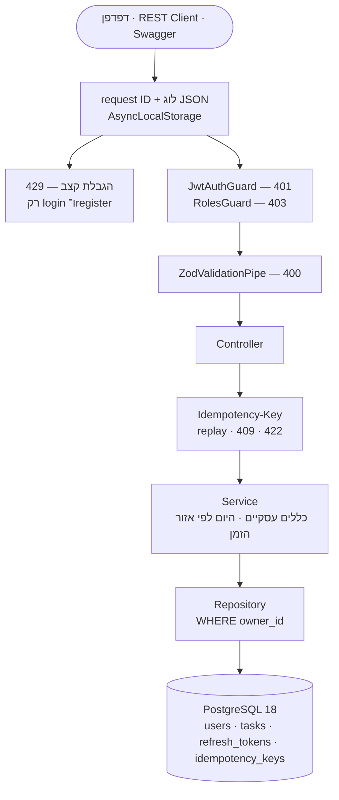

<!-- נוצר אוטומטית: node course-src/scripts/make-readme.mjs — לא לערוך ביד -->
<p align="center">
  
</p>

<div dir="rtl">

<p align="center">
  <b><a href="https://yeudaba.github.io/backend-course-he/">לקריאת הקורס באתר</a></b>
  &nbsp;·&nbsp; <a href="#התחלה-מהירה">התחלה מהירה</a>
  &nbsp;·&nbsp; <a href="#תוכן-הקורס">תוכן הקורס</a>
  &nbsp;·&nbsp; <a href="#פרויקט-2--הפרויקט-שגדל">פרויקט 2</a>
</p>

## על הקורס

קורס Backend שלם בעברית, ללמידה עצמית: מ"מה זה משתנה" ועד שרת **NestJS** מאובטח מעל **PostgreSQL**, שרץ ב־Docker — ובסופו פרויקט דגל לתיק העבודות. המטרה אחת: **משרת Junior Backend**.

הקורס נבנה ללומד אחד ספציפי — בוגר הנדסת תוכנה שזוכר את המושגים אבל לא את התחביר, ועובד על Mac עם VS Code. לכן כל פרק מתחיל במה שצריך להתקין, וכל שיעור מסביר "למה" לפני "איך".

| פרקים ופרויקטים | שיעורים | תרגילים | בדיקות אוטומטיות | דוגמאות שרצות באימות |
|:-:|:-:|:-:|:-:|:-:|
| **28** | **120** | **620** | **402** | **574** |

## מה שונה כאן

**הכול נבדק בהרצה.** כל דוגמת קוד בשיעור רצה בזמן הבנייה, והפלט שלה חייב להיות זהה למה שכתוב בשיעור. כל בדיקה אוטומטית חייבת לעבור על הפתרון — ולהיכשל על קובץ ההתחלה. שאילתות SQL רצות מול PostgreSQL 18 אמיתי, ובדיקות Docker בונות ומריצות קונטיינרים.

**25 תרגילים בכל פרק, בחמש רמות** — הבנה (E01–E05), כתיבה (E06–E12), שילוב (E13–E19), תיקון באגים בקוד אמיתי (E20–E23), ואתגר (E24–E25). לכל תרגיל שני רמזים, פתרון מוסבר וטעויות נפוצות, בדף נפרד.

**מפרק 22 הלומד כותב בדיקות בעצמו** — והבודק מכניס באגים לקוד (mutation testing) ומוודא שהבדיקות תופסות אותם.

**עברית פשוטה, מונחים באנגלית.** מילון עם הגייה, איור בכל שיעור (מותאם למצב כהה), וקופסת "לפני שמתחילים" בכל פרק.

## מפת הדרך

| חטיבה | מה לומדים | התקדמות | |
|---|---|---|:-:|
| **חטיבה א׳** | יסודות JavaScript | <code>▰▰▰▰▰▰▰▰▰▰</code> | 12/12 |
| **חטיבה ב׳** | TypeScript ו־Node.js | <code>▰▰▰▰▰▰▰▰▰▰</code> | 4/4 |
| **חטיבה ג׳** | שרת, מסד נתונים ו־HTML בסיסי | <code>▰▰▰▰▰▰▰▰▰▰</code> | 7/7 |
| **חטיבה ד׳** | רמת תעשייה | <code>▰▰▰▰▰▰▰▱▱▱</code> | 5/7 |
| **חטיבה ה׳** | ראיונות והרחבות | <code>▱▱▱▱▱▱▱▱▱▱</code> | 0/5 |

</div>

<div dir="rtl">

## תוכן הקורס

### חטיבה א׳ — יסודות JavaScript

| פרק | נושא | שיעורים | תרגילים | בדיקות | מצב |
|---|---|:-:|:-:|:-:|:-:|
| [פרק 0](backend-course/00-setup/index.html) | הכנה: המחשב, VS Code והרצה ראשונה | 5 | 8 | — | ✔ |
| [פרק 1](backend-course/01-values-variables/index.html) | ערכים ומשתנים <sub>(רענון)</sub> | 3 | 25 | — | ✔ |
| [פרק 2](backend-course/02-operators-strings/index.html) | פעולות ומחרוזות <sub>(רענון)</sub> | 4 | 25 | — | ✔ |
| [פרק 3](backend-course/03-conditions/index.html) | תנאים <sub>(רענון)</sub> | 4 | 25 | — | ✔ |
| [פרק 4](backend-course/04-loops/index.html) | לולאות <sub>(רענון)</sub> | 4 | 25 | — | ✔ |
| [פרק 5](backend-course/05-functions/index.html) | פונקציות <sub>(רענון)</sub> | 4 | 25 | 20 | ✔ |
| [פרק 6](backend-course/06-arrays/index.html) | מערכים <sub>(רענון)</sub> | 4 | 25 | 20 | ✔ |
| [פרק 7](backend-course/07-objects/index.html) | אובייקטים <sub>(רענון)</sub> | 4 | 25 | 20 | ✔ |
| [פרק 8](backend-course/08-modules-errors/index.html) | ארגון קוד ואיתור תקלות | 4 | 25 | 20 | ✔ |
| [פרויקט 1](backend-course/08p-project-expenses/index.html) | מנהל הוצאות בשורת הפקודה | 6 | — | 3 | ✔ |
| [פרק 9](backend-course/09-git/index.html) | Git ו־GitHub | 4 | 25 | — | ✔ |
| [פרק 10](backend-course/10-async/index.html) | אסינכרוניות | 4 | 25 | 20 | ✔ |

<details>
<summary><b>כל השיעורים בחטיבה</b></summary>

**פרק 0 — הכנה: המחשב, VS Code והרצה ראשונה**

1. קבצים, תיקיות ונתיבים
2. התקנת VS Code ו־Node.js
3. סיור ב־VS Code
4. ה־Terminal: שש פקודות שצריך
5. תוכנית ראשונה וקריאת שגיאות

**פרק 1 — ערכים ומשתנים**

1. ערכים: טקסט, מספרים ואמת/שקר
2. משתנים: const ו־let
3. undefined, null, ומה עם var

**פרק 2 — פעולות ומחרוזות**

1. חשבון וסדר פעולות
2. מחרוזות ו־template literals
3. המרות, NaN ומלכודות
4. גישור: קריאת ביטוי צעד אחר צעד <sub>יחידת גישור</sub>

**פרק 3 — תנאים**

1. השוואות: === ו־!==
2. if, else if, else
3. &&, ||, ! ו־truthy/falsy
4. ternary, switch ובדיקת קלט

**פרק 4 — לולאות**

1. while — חזור כל עוד
2. for — לולאה עם מונה
3. דפוסי צבירה, break ו־continue
4. לולאות על מחרוזות ולולאות מקוננות

**פרק 5 — פונקציות**

1. פונקציה ראשונה: פרמטרים ו־return
2. return לעומק, ברירות מחדל ו־guard clauses
3. arrow functions, scope ופונקציה כערך
4. גישור: פירוק בעיה לפונקציות + הבודק האוטומטי <sub>יחידת גישור</sub>

**פרק 6 — מערכים**

1. מערך: יצירה, אינדקס, הוספה והסרה
2. מעבר על מערך, split ו־join
3. map, filter, find, some, every
4. reduce, sort, ומה משנה את המערך

**פרק 7 — אובייקטים**

1. אובייקט: שדות, גישה ושינוי
2. מערך של אובייקטים
3. הפניות, העתקה, destructuring ו־JSON
4. Map, Set וגישור: נתונים מקושרים <sub>כולל יחידת גישור</sub>

**פרק 8 — ארגון קוד ואיתור תקלות**

1. מודולים: קוד בכמה קבצים
2. throw, try/catch ו־finally
3. stack trace וה־Debugger של VS Code
4. ESLint ושיטה לאיתור באגים

**פרויקט 1 — מנהל הוצאות בשורת הפקודה**

1. תכנון: מבנה, כלים חדשים והקמה
2. שלב 1: הלוגיקה (expenses.js) <sub>🤖 PR1-LOGIC</sub>
3. שלב 2: שמירה בקובץ (storage.js) <sub>🤖 PR1-STORAGE</sub>
4. שלב 3: שורת הפקודה (cli.js) <sub>🤖 PR1-CLI</sub>
5. שלב 4: גימור, README ובדיקה עצמית
6. פתרון לדוגמה והחלטות עיצוב <sub>🔒 אחרי שסיימת</sub>

**פרק 9 — Git ו־GitHub**

1. commit ראשון: שלושת האזורים
2. diff, ביטול שינויים ו־.gitignore
3. branches, merge והתנגשויות
4. GitHub: push, Pull Request וסודות

**פרק 10 — אסינכרוניות**

1. סינכרוני, אסינכרוני ו־event loop
2. callbacks ו־error-first
3. Promises
4. async/await, מקביליות וכשלים <sub>כולל יחידת גישור</sub>

</details>

### חטיבה ב׳ — TypeScript ו־Node.js

| פרק | נושא | שיעורים | תרגילים | בדיקות | מצב |
|---|---|:-:|:-:|:-:|:-:|
| [פרק 11](backend-course/11-typescript/index.html) | TypeScript בסיסי | 4 | 25 | 20 | ✔ |
| [פרק 12](backend-course/12-design/index.html) | מודלים ותכנון קוד | 4 | 25 | 20 | ✔ |
| [פרק 13](backend-course/13-node-npm/index.html) | Node.js ו־npm | 4 | 25 | 20 | ✔ |
| [פרק 14](backend-course/14-http/index.html) | HTTP ורשת בסיסית | 4 | 25 | 20 | ✔ |

<details>
<summary><b>כל השיעורים בחטיבה</b></summary>

**פרק 11 — TypeScript בסיסי**

1. מה זה TypeScript, וטיפוסים בסיסיים
2. אובייקטים, מערכים ופונקציות
3. union, literal types ו־narrowing
4. unknown, any ו־type guards

**פרק 12 — מודלים ותכנון קוד**

1. מחלקות
2. שגיאות משלך, ירושה והרכבה
3. interface, repository, service והזרקת תלויות
4. גישור: טיפוסים מול בדיקה בזמן ריצה <sub>יחידת גישור</sub>

**פרק 13 — Node.js ו־npm**

1. npm ו־package.json
2. process: ארגומנטים, סביבה וקוד יציאה
3. הגדרות וסודות: .env
4. המודולים המובנים: fs, path, crypto, readline

**פרק 14 — HTTP ורשת בסיסית**

1. בקשה ותשובה: URL, methods ו־status
2. headers, JSON ו־stateless
3. כלים: curl, REST Client ו־DevTools
4. שרת עם node:http ולקוח עם fetch

</details>

### חטיבה ג׳ — שרת, מסד נתונים ו־HTML בסיסי

| פרק | נושא | שיעורים | תרגילים | בדיקות | מצב |
|---|---|:-:|:-:|:-:|:-:|
| [פרק 15](backend-course/15-express/index.html) | Express ו־REST | 4 | 25 | 20 | ✔ |
| [פרויקט 2](backend-course/15p-project-tasks/index.html) | API לניהול משימות — שלב א׳: בזיכרון | 6 | — | 5 | ✔ |
| [יחידה 15.5](backend-course/15w-web-bridge/index.html) | גישור: HTML, CSS ו־fetch | 4 | 12 | 6 | ✔ |
| [פרק 16](backend-course/16-sql/index.html) | SQL מהיסוד | 4 | 25 | 20 | ✔ |
| [פרק 17](backend-course/17-relations/index.html) | קשרים ושאילתות | 4 | 25 | 20 | ✔ |
| [פרק 18](backend-course/18-consistency/index.html) | עקביות וביצועים | 4 | 25 | 20 | ✔ |
| [פרק 19](backend-course/19-prisma/index.html) | Prisma ו־migrations | 4 | 25 | 21 | ✔ |

<details>
<summary><b>כל השיעורים בחטיבה</b></summary>

**פרק 15 — Express ו־REST**

1. השרת הראשון ב־Express
2. middleware, שגיאות ו־404
3. תכנון REST: כתובות, pagination ושכבות
4. בדיקת קלט עם Zod

**פרויקט 2 — API לניהול משימות — שלב א׳: בזיכרון**

1. תכנון, הקמה ו־Git
2. שלב 1: schema, repository ו־service <sub>🤖 PR2-SCHEMA, PR2-SERVICE</sub>
3. שלב 2: routes, ולידציה ושגיאות <sub>🤖 PR2-API</sub>
4. שלב 3: סינון, מיון, pagination וסטטיסטיקה <sub>🤖 PR2-LIST</sub>
5. שלב 4: README, GitHub ובדיקה עצמית
6. פתרון לדוגמה והחלטות עיצוב <sub>🔒 אחרי שסיימת</sub>

**יחידה 15.5 — גישור: HTML, CSS ו־fetch**

1. HTML: מבנה, טקסט וטפסים
2. CSS: מספיק כדי שלא ייראה שבור
3. JavaScript בדפדפן ו־CORS
4. דף הדגמה לפרויקט 2 <sub>🤖 PR2-WEB</sub>

**פרק 16 — SQL מהיסוד**

1. מסד נתונים, טבלאות ו־psql
2. SELECT: לשלוף, לסנן, למיין
3. NULL וצבירות
4. יצירת טבלאות ושינוי נתונים

**פרק 17 — קשרים ושאילתות**

1. מפתחות וקשרים בין טבלאות
2. JOIN: לשלב טבלאות
3. GROUP BY ו־HAVING
4. תת־שאילתות, WITH ופונקציות חלון

**פרק 18 — עקביות וביצועים**

1. Transactions: הכול או כלום
2. מקביליות ו־race conditions
3. Indexes ו־EXPLAIN
4. N+1 ו־pagination מהירה

**פרק 19 — Prisma ו־migrations**

1. ORM, Prisma והחיבור הראשון
2. Schema, קשרים ו־migrations
3. שאילתות, transactions ושגיאות
4. פרויקט 2 עובר ל־PostgreSQL <sub>🤖 PR2-DB</sub>

</details>

### חטיבה ד׳ — רמת תעשייה

| פרק | נושא | שיעורים | תרגילים | בדיקות | מצב |
|---|---|:-:|:-:|:-:|:-:|
| [פרק 20](backend-course/20-nestjs/index.html) | NestJS | 4 | 25 | 21 | ✔ |
| [פרק 21](backend-course/21-auth/index.html) | כניסה והרשאות | 5 | 25 | 22 | ✔ |
| [פרק 22](backend-course/22-testing/index.html) | בדיקות | 5 | 25 | 21 | ✔ |
| [פרק 23](backend-course/23-docker/index.html) | Linux ו־Docker | 5 | 25 | 21 | ✔ |
| [פרק 24](backend-course/24-production/index.html) | מוכן לפרודקשן: לוגים, זמן, Idempotency והגבלת קצב | 5 | 25 | 22 | ✔ |
| פרק 25 | CI ופריסה <br><sub>GitHub Actions, secrets, healthcheck, HTTPS — קישור חי</sub> | | | | בתוכנית |
| פרויקט 3 | פרויקט הדגל: חנות ציוד קפה <br><sub>JWT, עגלה←הזמנה, transactions, idempotency, Docker, CI</sub> | | | | בתוכנית |

<details>
<summary><b>כל השיעורים בחטיבה</b></summary>

**פרק 20 — NestJS**

1. Modules, controllers ו־providers
2. Controllers, DTOs ו־validation
3. Dependency injection, guards ו־filters
4. Swagger, בדיקות ופרויקט 2 ב־Nest <sub>🤖 PR2-NEST</sub>

**פרק 21 — כניסה והרשאות**

1. סיסמאות: hashing ו־bcrypt
2. JWT ו־guard של התחברות
3. refresh tokens ויציאה
4. הרשאות, בעלות ו־OWASP
5. פרויקט 2, שלב ד׳: משתמשים <sub>🤖 PR2-AUTH</sub>

**פרק 22 — בדיקות**

1. למה, מה, ו־node:test
2. כפילים, זמן וקוד בדיק
3. בדיקות HTTP ומסד בדיקות
4. Jest, Nest, כיסוי ו־mutation testing
5. פרויקט 2, שלב ה׳: בדיקות <sub>🤖 PR2-TESTS</sub>

**פרק 23 — Linux ו־Docker**

1. Linux ו־shell למפתחי Backend
2. Docker: images, containers ו־volumes
3. Dockerfile טוב
4. Docker Compose
5. פרויקט 2, שלב ו׳: הכול בפקודה אחת <sub>🤖 PR2-DOCKER</sub>

**פרק 24 — מוכן לפרודקשן: לוגים, זמן, Idempotency והגבלת קצב**

1. לוגים מובנים ו־request ID
2. זמן, אזורי זמן ושעון קיץ
3. Idempotency: לשלוח שוב בלי לחשוש
4. הגבלת קצב וכיבוי מסודר
5. פרויקט 2, שלב ז׳: מוכן לפרודקשן <sub>🤖 PR2-PROD</sub>

</details>

### חטיבה ה׳ — ראיונות והרחבות

| פרק | נושא | שיעורים | תרגילים | בדיקות | מצב |
|---|---|:-:|:-:|:-:|:-:|
| פרק 26 | Cache ותורים <br><sub>Redis דרך Docker</sub> | | | | בתוכנית |
| פרק 27 | אלגוריתמים וראיונות <br><sub>שאלות ראיון, סיבוכיות</sub> | | | | בתוכנית |
| פרק 28 | תכנון מערכת <br><sub>רשות, ברמת Junior</sub> | | | | בתוכנית |
| פרק 29 | AI ב־Backend <br><sub>רשות</sub> | | | | בתוכנית |
| פרק 30 | תיק עבודות וחיפוש עבודה <br><sub>GitHub, קורות חיים, LinkedIn, סימולציות ראיון</sub> | | | | בתוכנית |

</div>

<div dir="rtl">

## פרויקט 2 — "הפרויקט שגדל"

אותו `tasks-api` עובר שמונה גלגולים לאורך הקורס. בכל שלב נוסף משהו — וה־API החיצוני נשאר זהה. כך רואים בפועל למה בונים בשכבות.

| שלב | פרק | מה נוסף | |
|:-:|:-:|---|:-:|
| א׳ | 15 | Express 5 + Zod, repository בזיכרון | ✔ |
| ב׳ | 19 | PostgreSQL + Prisma, סינון ומיון במסד | ✔ |
| ג׳ | 20 | NestJS + Swagger — אותו API בדיוק | ✔ |
| ד׳ | 21 | משתמשים, JWT, refresh tokens, תפקידים; כל אחד רואה רק את שלו | ✔ |
| ה׳ | 22 | בדיקות: unit, e2e ו־integration עם Jest ו־supertest | ✔ |
| ו׳ | 23 | Dockerfile ו־Docker Compose — הכול עולה בפקודה אחת | ✔ |
| ז׳ | 24 | לוגים עם request ID, אזורי זמן, Idempotency-Key, הגבלת קצב | ✔ |
| ח׳ | 25 | CI ופריסה — קישור חי | בתוכנית |

### הארכיטקטורה היום (שלב ז׳)

בקשה עוברת מלמעלה למטה. כל שכבה יכולה לעצור אותה עם שגיאה אחידה — `{ error: { code, message } }`.

</div>



<div dir="rtl">

## התחלה מהירה

### ללומד

מורידים, מעתיקים את חומרי הקורס לתיקיית עבודה, ומתקינים:

</div>

```bash
git clone https://github.com/yeudaba/backend-course-he.git ~/Desktop/Backend
mkdir -p ~/dev && cp -R ~/Desktop/Backend/backend-course ~/dev/backend-course
cd ~/dev/backend-course && npm install
open README.html
```

<div dir="rtl">

פותרים בקובצי ההתחלה (תיקיית `starter`) של כל פרק, ובודקים עם `npm run check`:

| מה בודקים | פקודה |
|---|---|
| תרגיל אחד | `npm run check P24-E06` |
| כל הפרק | `npm run check P24` |
| הפרויקט | `npm run check PR2-PROD -- --dir ~/dev/tasks-api` |

</div>

<div dir="rtl">

### למפתח

הקוד של הקורס נמצא ב־`course-src`, ו־`backend-course` נבנה ממנו. אימות מריץ כל דוגמה וכל בדיקה, ולכן צריך Node 24 ו־PostgreSQL. בענן או בלינוקס, `cloud-setup.sh` מעלה את PostgreSQL 18 ב־Docker ומתקין את Node 24:

</div>

```bash
cd course-src && npm ci && cd ..
bash course-src/scripts/cloud-setup.sh
export PATH=/opt/node24/bin:$PATH
```

<div dir="rtl">

| מה | פקודה |
|---|---|
| לבנות ולאמת פרק אחד | `node course-src/build.mjs --verify 24` |
| לבנות ולאמת הכול | `node course-src/build.mjs --verify` |
| לעדכן את ה־README | `node course-src/scripts/make-readme.mjs` |

## מבנה המאגר

| תיקייה או קובץ | מה יש בו |
|---|---|
| `backend-course` | מה שהלומד מקבל: דפי HTML, קובצי התחלה, פתרונות, בדיקות והבודק |
| `course-src/chapters` | המקור — תיקייה לכל פרק: שיעורים, תרגילים, בדיקות ופתרונות. **כאן עורכים** |
| `course-src/build.mjs` | בונה את `backend-course` ומאמת כל דוגמה ובדיקה |
| `course-src/root` | מועתק לשורש `backend-course`: `package.json` והבודק |
| `course-src/scripts` | `cloud-setup.sh`, `make-readme.mjs` |
| `HANDOFF_המשך_הפרויקט.md` | מצב הפרויקט וכל הגילויים הטכניים מהדרך |
| `אפיון_קורס_Backend_v2.md` | האפיון של הקורס |

</div>

<div dir="rtl">

## הטכנולוגיות

| תחום | כלים |
|---|---|
| שפה | JavaScript · TypeScript · Node.js 24 |
| שרת | Express 5 · NestJS 12 · Zod 4 · Swagger |
| מסד נתונים | PostgreSQL 18 · SQL · Prisma 7 |
| אבטחה | bcrypt · JWT · refresh tokens · הגבלת קצב · OWASP API Top 10 |
| בדיקות | node:test · Jest · supertest · mutation testing |
| תשתית | Linux · bash · Docker · Docker Compose · nginx |
| פרודקשן | לוגים מובנים · request ID · אזורי זמן · Idempotency-Key · graceful shutdown |

---

<p align="center"><sub>נבנה פרק אחר פרק. כל פלט בו נבדק בהרצה אמיתית.</sub></p>

</div>
