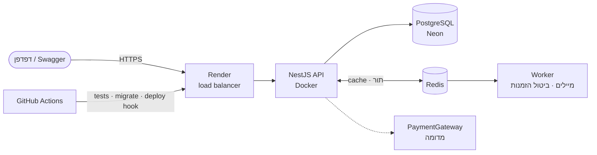
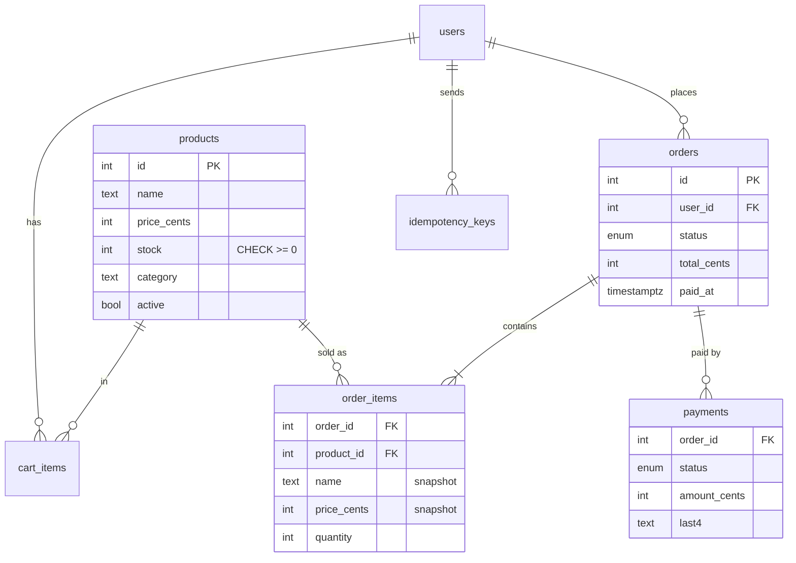

# ☕ coffee-shop


**API של חנות ציוד קפה: לקוחות מזמינים ומשלמים, מנהל מנהל מלאי — בלי מלאי שלילי ובלי הזמנות כפולות, גם תחת עומס.**

- 🌐 **חי:** https://YOUR-SERVICE.onrender.com · 📖 **Swagger:** https://YOUR-SERVICE.onrender.com/docs · 🛒 **דף הדגמה:** https://YOUR-WEB.onrender.com
- 💳 תשלום מדומה. כרטיס לבדיקה: `4242 4242 4242 4242`; נדחה: `4000 0000 0000 0002`

## הרצה מקומית

```bash
cp .env.example .env        # ומלא JWT_SECRET ו־ADMIN_PASSWORD
docker compose up --build   # מסד, Redis, migrations, נתוני הדגמה, API ודף
open http://localhost:5500  # API: http://localhost:3000/docs
```

## ארכיטקטורה



בתוך ה־API: `AuthGuard` גלובלי (JWT, ואז תפקיד) ← `ZodValidationPipe` ← controller ← service ← Prisma. שגיאות — תמיד `{ error: { code, message, details? } }`.

## מסד הנתונים



## ה־API

| בקשה | מי | מה |
|---|---|---|
| `POST /auth/register` · `POST /auth/login` · `GET /auth/me` | כולם | JWT; תמיד customer |
| `GET /products?q=&category=&minPrice=&maxPrice=&inStock=&sort=&page=&limit=` | כולם | חיפוש, סינון, מיון, pagination |
| `POST/PATCH/DELETE /products` | admin | מחיקה רכה |
| `GET /cart` · `PUT /cart/items/:id` · `DELETE /cart/items/:id` | לקוח | `PUT` קובע כמות |
| `POST /orders` 🔑 | לקוח | עגלה ← הזמנה. `409 OUT_OF_STOCK` עם פירוט |
| `POST /orders/:id/pay` 🔑 | לקוח | `402 PAYMENT_DECLINED` בכישלון |
| `POST /orders/:id/cancel` | בעלים / admin | מחזיר מלאי; לא אחרי משלוח |
| `POST /orders/:id/ship` | admin | רק הזמנה ששולמה |
| `GET /emails` | admin | "תיבת הדואר" המדומה — מיילי האישור שנשלחו |
| `GET /health` · `/ready` · `/version` | כולם | לפלטפורמה ולבדיקת העשן |

🔑 = חובה `Idempotency-Key`.

## החלטות טכניות

- **מלאי: `UPDATE … WHERE stock >= quantity`, לא "בדוק ואז עדכן".** בדקתי: הגרסה "SELECT, בדיקה, UPDATE" מכרה 12 יחידות מתוך 3 במלאי כש־12 לקוחות הזמינו במקביל. העדכון המותנה אטומי: PostgreSQL נועל את השורה, והתנאי נבדק שוב על הערך העדכני. המוצרים ננעלים לפי `id` — שתי הזמנות לא ייתקעו זו בזו (deadlock).
- **`CHECK (stock >= 0)` במסד, בנוסף לקוד.** אם יום אחד מישהו יכתוב עדכון מלאי בדרך אחרת — המסד לא ישמור מספר שלילי.
- **טרנזקציה אחת להזמנה.** מלאי יורד, הזמנה נוצרת, עגלה מתרוקנת — הכול או כלום. מוצר אחד חסר ← גם המלאי של האחרים חוזר.
- **המחיר והשם נשמרים בשורת ההזמנה.** הזמנה היא מסמך היסטורי: שינוי מחיר מחר לא משנה קבלה של היום.
- **כסף במספרים שלמים (אגורות).** `0.1 + 0.2 !== 0.3`.
- **Idempotency-Key על הזמנה ועל תשלום, עם `UNIQUE (user_id, key)` במסד.** לחיצה כפולה (או retry של הרשת) לא יוצרת הזמנה שנייה ולא חיוב שני. תשובות 4xx נשמרות; 5xx — לא, כדי שאפשר יהיה לנסות שוב.
- **מעברי מצב מותנים** (`UPDATE … WHERE status IN (…)`) ומכונת מצבים אחת (`order-status.ts`): שני ביטולים במקביל מחזירים מלאי פעם אחת.
- **תשלום מאחורי ממשק `PaymentGateway`.** הספק המדומה משתמש במספרי הכרטיסים "לבדיקות" המקובלים; ספק אמיתי — מחליפים מחלקה אחת. נשמרות רק 4 ספרות אחרונות.
- **Redis הוא אופטימיזציה, לא תלות.** בלי `REDIS_URL` הכול עובד (בלי cache, ומייל האישור נשלח מיד), ואם Redis נופל באמצע — בקשה לרשימה פשוט הולכת למסד. `X-Cache: HIT/MISS/OFF` בכל תשובה של `GET /products`.
- **ביטול ה־cache עם "גרסה", לא מחיקה.** לרשימת המוצרים יש עשרות וריאציות (`q`, `sort`, `page`…). במקום לחפש ולמחוק את כולן — `INCR v:products`, והמפתחות הישנים כבר לא נקראים ומתים ב־TTL. ומלאי הוא חלק מהרשימה — לכן גם הזמנה וביטול מבטלים את ה־cache.
- **תור (BullMQ) למה שלא חייב לקרות בזמן הבקשה.** מייל אישור: הלקוח לא מחכה ל־SMTP, וכישלון זמני — retry עם backoff. ביטול הזמנה שלא שולמה תוך 30 דקות: עבודה עם `delay`. `jobId` קבוע לכל (סוג, הזמנה) — הוספה כפולה היא עבודה אחת, ו־`UNIQUE (kind, order_id)` בטבלת המיילים — retry לא שולח פעמיים.
- **התפקיד נקרא מהמסד בכל בקשה, לא מהטוקן.** מנהל שהורד מתפקידו מאבד הרשאות מיד.
- **הזמנה של משתמש אחר ← 404, לא 403.** לא מגלים שהיא קיימת.

## בדיקות

- `npm test` — unit: מכונת המצבים, Luhn, הגדרות.
- `npm run test:e2e` — מול PostgreSQL אמיתי (schema נפרד לכל ריצה): זרימה מלאה, **מרוץ של 10 לקוחות על 3 יחידות**, ה־CHECK, ביטול.
- ב־CI (GitHub Actions) — שניהם, ועוד typecheck, build של ה־Docker image ובדיקה שהוא עולה.

## מה הייתי משפר עם עוד זמן

- worker בתהליך נפרד (`WORKER=false` ב־API), ודף ניהול לתור (Bull Board).
- outbox: מייל האישור נכתב לטבלה באותה טרנזקציה של התשלום, ותהליך מעביר לתור — כך אין מצב שהתשלום נשמר והעבודה לא נוספה.
- refresh tokens (היום — access token לשעה).
- ספק תשלום אמיתי עם webhooks, במקום תשובה סינכרונית.
- תמונות למוצרים (S3), ודף ניהול למנהל.
